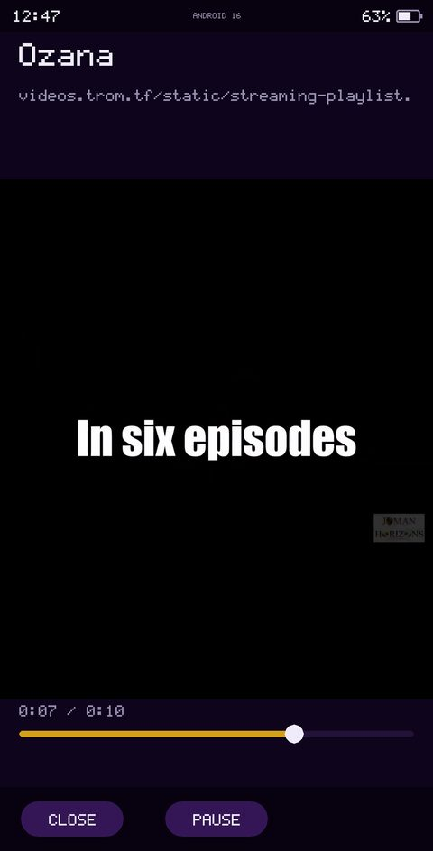
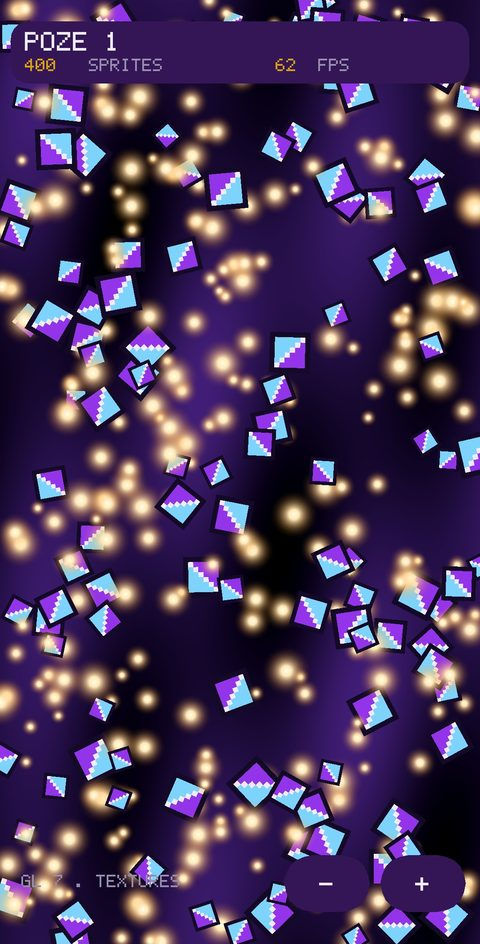
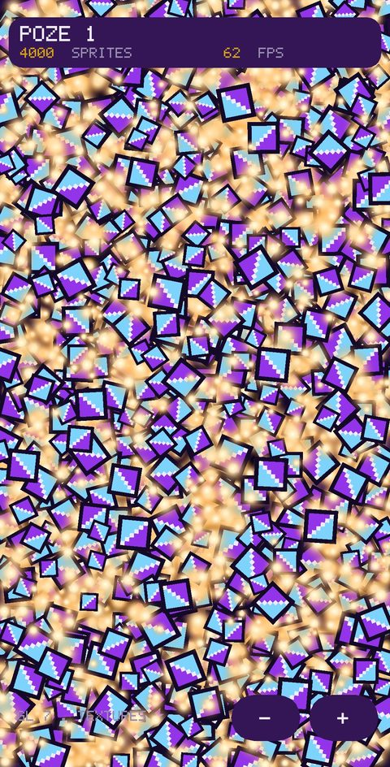

# Ozana — a web browser written in Oberon, on a phone

Ozana reads the web herself. She takes pages apart in Oberon‑07, with their words, links, forms and pictures, and the phone's graphics card draws them. She was written and compiled on a Samsung Galaxy A15, without a computer, with **Byz7** (OLL2, an Oberon‑07 → LLVM compiler that runs on the phone).

In Romanian, “Ozana” sounds like “o zână”, a fairy. She is the same fairy as **Nora**, the browser inside **Pixipogo (Cubicum N)**, the small operating system in Oberon from the same workshop.

**The presentation page:** [index.html](index.html). With GitHub Pages on, it is at `https://ion-pion.github.io/ozana/`.

| | | |
|---|---|---|
|  |  |  |
| A PeerTube film in her own player | Textures on the graphics card (Poze 1) | 4000 sprites, 62 frames a second |

## What she does

- **Pages read in Oberon.** She has her own HTML reader and layout. That covers links, forms (GET and POST), bookmarks, history, find in the page, copy and paste, and instant BACK.
- **Pictures decoded in Oberon (Pic6).** She reads JPEG (baseline and progressive), PNG (with Adam7), GIF and WEBP (VP8 with its loop filter). On the test pictures the WEBP output is identical to libwebp, and JPEG 4:2:0 is within 4 levels of libjpeg (Pillow).
- **On the graphics card (OllGL7).** Every picture becomes a texture, so it is drawn sharp at the screen's real resolution. Poze 1, the test app, draws 4000 sprites at 62 fps on the Galaxy A15.
- **Films and sounds** play in her own player. Films given freely on PeerTube, the Internet Archive and Wikimedia Commons are found and read in Oberon (Filme1). In the address bar: `pt cats`, `ia popeye`, `wc volcano`.
- **The whole web, when needed.** YouTube, TikTok, Vimeo and Twitch open in a box where the phone's own web engine runs the site and its own player. A YouTube film can go to NewPipe with one button.
- **Like the big ones.** She has up to 8 tabs, private tabs, saved pages to read without the net, and Share. Downloads of any size go through the phone's downloader, and the box can ask for sites as a computer would.

## What she does not do (yet)

- Her own engine runs no JavaScript and keeps no cookies. Sites that are only JavaScript, and logging in, go through the box (the phone's own engine).
- She does not take YouTube's films from YouTube. They play in YouTube's own player in the box, or in NewPipe.
- Pages are shown as text, links and pictures, without the sites' own CSS layout.
- She does not read lossless WEBP or animated pictures yet.

## The files

| File | What it is |
|---|---|
| `Ozana5.Mod` | The app: Nora living alone, named Ozana |
| `Nora18.Mod` | The browser |
| `Pic6.Mod` | The decoders for JPEG, PNG, GIF and WEBP |
| `Filme1.Mod` | The JSON reader and the free film sources |
| `OllGL7.Mod` | Drawing on the graphics card, with textures |
| `OllGL6t.Mod` | The old name `OllGL6`, made of OllGL7, so that the older modules draw in the same frame |
| `Motor2.Mod`, `Desk6t.Mod` (module Desk6), `Keys1.Mod`, `Gazda4.Mod` | The frame loop, the look, the keyboard, the files between the app and the phone |
| `Poze1.Mod` | Poze 1, the test app for textures and sprites |
| `ecran-cubn49.dex` | The window: the thin Android part (network, GLES 2, film player, the box into the whole web, downloads, Share) |
| `Tex.java`, `NoraWeb.java` | The sources of the window's newer parts (textures; the box into the whole web) |

`OllGL4.Mod`, `Synth9.Mod`, `Text1.Mod` and `Fs2.Mod` come from the Byz7 workspace of Pixipogo. They are not included here yet.

## Build

In Byz7, copy `ecran-cubn49.dex` as `ecran.dex` into its tools folder (`$EULA_UNELTE`), then run:

```
OLL2.Apk Motor2.Mod OllGL4.Mod OllGL7.Mod OllGL6t.Mod Synth9.Mod Text1.Mod Keys1.Mod Fs2.Mod Gazda4.Mod Desk6.Mod Pic6.Mod Filme1.Mod Nora18.Mod Ozana5.Mod "Ozana 5"
```

(`Desk6t.Mod` is copied as `Desk6.Mod` first.) The result is an Android app with its own name and icon. Most of it is native ARM64 code compiled from Oberon.

## Authors

Ion Paraschiv (Pion) · Jahbalon Research, Iași, Romania · with Claude (Anthropic).

*E pur si torque.* Build first, demonstrate after.

## License

MIT, see [LICENSE](LICENSE).
